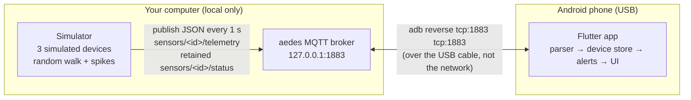

# Sensor Dashboard

An Android app that shows **live sensor data** from devices on an MQTT network: live gauges,
a rolling chart, min/max/average, threshold alerts and a clear connection status.

Phase 1 runs entirely on your own machine. A small local broker and a simulator stand in for
real hardware, so it can be demonstrated anywhere with nothing but a laptop and a USB phone.
**All data shown is simulated.** No cloud, no accounts, no real credentials.

> **Demo video:** _[link to be added]_

| Dashboard | Device detail | Alert | Settings | Offline |
|-----------|---------------|-------|----------|---------|
| _screenshot_ | _screenshot_ | _screenshot_ | _screenshot_ | _screenshot_ |

<!-- Replace with images from evidence/screenshots/ once approved for sharing. -->

## Features

- **Live dashboard:** one card per device with gauges for temperature, humidity, pressure and
  battery, an online/offline chip, and "updated N s ago".
- **Device detail:** rolling line chart of the last 60 readings per sensor, with threshold lines
  and min / average / max.
- **Threshold alerts:** configurable min/max per sensor. Breaches show a banner and are kept in an
  alert history (active / resolved). Hysteresis prevents alert floods when a value hovers on a limit.
- **Connection status:** always visible. Automatic reconnect with backoff (1, 2, 4, 8, 10 s),
  a countdown, and a "Retry now" button. Last values stay visible (greyed out) while offline.
- **Settings:** broker host, port and topic prefix, thresholds, and light/dark/system theme,
  saved on the device.
- **Robust UI:** loading, empty and error states on every screen; friendly messages instead of
  raw exceptions; malformed messages are ignored safely.
- **Material 3:** light and dark themes.

## Tech stack

| Part | Technology |
|------|------------|
| Mobile app | Flutter (Android), Material 3, `provider`, `mqtt_client`, `fl_chart`, `shared_preferences` |
| Broker | Node.js + [aedes](https://github.com/moscajs/aedes) MQTT broker, bound to `127.0.0.1:1883` |
| Simulator | Node.js + `mqtt`, 3 simulated devices (greenhouse, warehouse, server-room) |
| Tests | `flutter_test` (unit + widget), `node:test` (broker + simulator smoke test) |

## Architecture



Inside the app, the code is organised by feature:

```
app/lib/
  app/            wiring (AppServices) and MaterialApp
  core/           MQTT gateway, theme, shared widgets
  features/
    telemetry/    models, parser, rolling stats, device store
    connection/   connect / reconnect / backoff + status bar
    dashboard/    device cards and gauges
    device_detail/ rolling chart and stats
    alerts/       alert engine, history, banner
    settings/     settings model, storage, screen
```

### MQTT topics

| Topic | Payload |
|-------|---------|
| `sensors/<deviceId>/telemetry` | `{"deviceId":"greenhouse","temperature":25.7,"humidity":70.5,"pressure":1012.2,"battery":96,"timestamp":"2026-11-17T06:14:20.705Z"}` |
| `sensors/<deviceId>/status` | `online` / `offline` (retained; `offline` is also the MQTT last will) |
| `sensors/_control/spike` | `<deviceId>` or `all`, used to trigger a demo spike |

## Run it locally

Requirements: Flutter SDK (stable), Android SDK platform-tools (`adb`), Node.js 20+, and an
Android phone with USB debugging on.

```bash
# 1. Broker + simulator (one terminal)
cd broker
npm install
npm run dev            # starts broker on 127.0.0.1:1883 and the simulator
#   or separately:  npm run broker   and   npm run simulate

# 2. Let the phone reach the broker over USB (no network exposure)
adb reverse tcp:1883 tcp:1883

# 3. Run the app
cd app
flutter pub get
flutter run

# 4. Demo an alert
cd broker
npm run spike -- greenhouse        # or: npm run simulate -- --spike greenhouse
```

In the app, the default broker is `127.0.0.1:1883` with prefix `sensors`. With `adb reverse`,
that address on the phone reaches the broker on your computer.

### Tests

```bash
cd app && flutter analyze && flutter test        # unit + widget tests
cd broker && npm test                            # broker + simulator smoke test
# Optional end-to-end (needs `npm run dev` running):
cd app && flutter test test/e2e
```

## Limitations (Phase 1)

- **Simulated data only.** No real sensors or device provisioning.
- **No security on the broker.** No TLS, no username/password. That is acceptable only because it
  binds to `127.0.0.1` and is reached over USB. Do not expose it to a network as-is.
- **History is in memory.** The chart keeps the last 60 readings per device, and alert history is
  lost when the app restarts. There is no database.
- **Android only.** iOS, web and desktop are not configured.
- **No background alerts.** Alerts appear only while the app is open (no push notifications).
- **The retained status lives in broker memory.** After a broker restart, device status is known
  again only once the simulator reconnects (about a second).

## Project notes

- `docs/decisions.md`: decisions made during the build and why.
- `docs/phase1-explained.md`: plain-English walkthrough.
- `docs/progress-log.md`: build log and status.
- `docs/demo-runbook.md`: steps to record the on-device demo.
