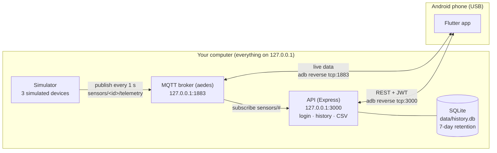

# Sensor Dashboard

An Android app for **live and historical sensor data** from devices on an MQTT network: live
gauges, a rolling chart, threshold alerts with notifications, a history view with CSV export,
and sign-in with admin and viewer roles.

Everything runs on your own machine. A local MQTT broker and a simulator stand in for real
hardware, and a small local API stores history in SQLite. It can be demonstrated anywhere with a
laptop and a USB phone. **All data shown is simulated.** No cloud, no third-party accounts, no
real credentials.

> **Phase 1 demo video:** [Watch on YouTube](https://youtube.com/shorts/mwZjokxNZyg) (unlisted, 1:07, simulated data)
>
> **Phase 2 demo video:** _[link to be added]_

| Sign in | Dashboard | History | Export | Alert notification | Offline |
|---------|-----------|---------|--------|--------------------|---------|
| _screenshot_ | _screenshot_ | _screenshot_ | _screenshot_ | _screenshot_ | _screenshot_ |

<!-- Replace with cropped images from evidence/screenshots/ once checked for anything personal. -->

## Features

**Live (Phase 1)**
- **Dashboard:** one card per device with gauges for temperature, humidity, pressure and battery,
  online/offline status and "updated N s ago".
- **Device detail:** rolling chart of the last 60 readings, threshold lines and min / average / max.
- **Threshold alerts:** banner, badge and alert history; hysteresis prevents alert floods.
- **Connection status:** always visible; automatic reconnect with backoff, plus "Retry now".
  Last values stay visible, greyed out, while offline.

**Accounts, history and export (Phase 2)**
- **Sign in** with email and password. The session token is kept in Android's secure storage, and
  you are signed out automatically when it expires (30 min). **Profile** shows your role.
- **Roles:** *admin* can change alert thresholds and delete history; *viewer* can look and export
  only. The server enforces this, and the app also hides what you can't do.
- **History** per device: last 1 h / 24 h / 7 d, with a chart, min / average / max, pull to
  refresh, and loading, empty and error states.
- **Export CSV** for the selected range, then share it via the Android share sheet.
- **Alert notifications:** a heads-up system notification when a reading crosses a threshold;
  tapping it opens the device. See [the limitation](#push-notification-limitation).
- **Settings:** server addresses, sensor group, alert thresholds (admin) and light/dark theme.
- **Robust UI:** friendly messages instead of raw errors; no developer jargon on screen.

## Tech stack

| Part | Technology |
|------|------------|
| Mobile app | Flutter (Android), Material 3, `provider`, `mqtt_client`, `fl_chart`, `http`, `flutter_secure_storage`, `flutter_local_notifications`, `share_plus`, `shared_preferences` |
| Broker | Node.js + aedes MQTT broker on `127.0.0.1:1883` |
| Simulator | Node.js + `mqtt`; 3 simulated devices (greenhouse, warehouse, server-room) |
| API | Node.js + Express 5 on `127.0.0.1:3000`; built-in `node:sqlite`; `jsonwebtoken`, `bcryptjs`, `helmet`, `express-rate-limit`, `zod` |
| Tests | `flutter_test` (unit + widget), Vitest + supertest (API), `node:test` (broker smoke test) |

## Architecture



The phone reaches both services over the **USB cable** with `adb reverse`, so nothing is exposed
to the network.

### API

| Method & path | Who | What |
|---------------|-----|------|
| `POST /auth/login` | anyone | `{email, password}` → `{token, expiresAt, user: {email, role}}` |
| `GET /me` | signed in | current user |
| `GET /devices` | signed in | devices with online status and latest reading |
| `GET /devices/:id/history?from=&to=&bucket=` | signed in | points (raw / `1m` / `15m` / `1h` averages) + min/avg/max |
| `GET /devices/:id/export.csv?from=&to=&bucket=` | signed in | CSV download |
| `GET /thresholds` | signed in | shared alert thresholds |
| `PUT /thresholds` | **admin** | change thresholds |
| `DELETE /devices/:id/history` | **admin** | delete a device's history |

`from` and `to` accept ISO 8601 or epoch milliseconds (default: the last hour). Raw data is limited
to 6-hour ranges; longer ranges must use a bucket.

### MQTT topics

| Topic | Payload |
|-------|---------|
| `sensors/<deviceId>/telemetry` | `{"deviceId":"greenhouse","temperature":25.7,"humidity":70.5,"pressure":1012.2,"battery":96,"timestamp":"…"}` |
| `sensors/<deviceId>/status` | `online` / `offline` (retained; `offline` is also the MQTT last will) |
| `sensors/_control/spike` | `<deviceId>` or `all`, used to trigger a demo spike |

## Run it locally (Windows)

Requirements: Flutter SDK (stable), Android SDK platform-tools (`adb`), Node.js 22.13+ (for
`node:sqlite`), and an Android phone with USB debugging on.

```powershell
# 1. Start the broker, simulator and API (installs npm packages the first time)
.\scripts\dev-up.ps1 -Phone            # -Phone also runs adb reverse for ports 1883 and 3000
#    options: -NoRandomSpikes for calm data
#             -Seed           fill the history with 7 days of simulated data first
#             -Seed -Force    ...even if the database already has recorded readings

# 2. Install and run the app
cd app
flutter pub get
flutter run

# 3. Trigger an alert on demand
cd broker
npm run spike -- greenhouse

# 4. Stop everything and clean up
.\scripts\dev-down.ps1 -Phone          # -Phone also removes adb reverse and turns stay-awake off
```

`dev-up` writes logs to `logs/` and process IDs to `.dev-pids.json` (both git-ignored); `dev-down`
stops only those processes. If PowerShell refuses to run local scripts, allow them for your user
once with `Set-ExecutionPolicy -Scope CurrentUser RemoteSigned`.

**Phone over USB (developer note).** The app's defaults are `http://127.0.0.1:3000` (server) and
`127.0.0.1:1883` (live data). On the phone those addresses work only while
`adb reverse tcp:1883 tcp:1883` and `adb reverse tcp:3000 tcp:3000` are active. `dev-up -Phone`
does this for you. If the app says it can't reach the server, check `adb reverse --list`.

### Simulated history (seed)

A fresh install has no history, so the 24 h and 7 d charts start empty. The seed script fills
`data/history.db` with **7 days of simulated readings, 1 per minute, for the 3 devices**
(30,240 rows): smooth day/night cycles, slow pressure "weather", small noise, and a few short
spikes that cross the default thresholds. The last 3 hours ease into the live simulator's values,
so seeded and live data join up without a jump.

```powershell
cd api
npm run seed                        # refuses if the database has readings the API recorded
npm run seed -- --force             # replace them anyway
npm run seed -- --days 3 --seed 7   # other length / different random pattern
```

Or start everything with `.\scripts\dev-up.ps1 -Seed` (add `-Force` to replace recorded data).
dev-up runs the seed **before** the API starts, so nothing else is writing to the database.

**Safety:** the seed replaces only the `readings` table; users and thresholds are not touched. It
remembers where its own data ends (`meta.seed_until`), so re-seeding over seeded data is allowed,
but anything the API recorded after that counts as real data and needs `--force`.

### Demo accounts (local demo only)

| Email | Password | Role |
|-------|----------|------|
| `admin@example.com` | `admin-demo-pass` | admin |
| `viewer@example.com` | `viewer-demo-pass` | viewer |

These exist only in your local `data/history.db` and protect nothing real. Set
`DEMO_ADMIN_PASSWORD` / `DEMO_VIEWER_PASSWORD` before the **first** API start to choose others, or
delete `data/history.db` to re-seed.

### Tests

```powershell
cd app;    flutter analyze; flutter test     # unit + widget tests
cd api;    npm test                          # Vitest + supertest (includes the seed)
cd broker; npm test                          # broker + simulator smoke test
```

## Security notes

**Protected**
- **Passwords** are hashed with bcrypt (cost 10) and never returned or logged. Unknown emails and
  wrong passwords get the same message and similar timing.
- **Login rate limit:** 5 failed attempts per 5 minutes per account and address, then HTTP 429.
- **Tokens:** HS256 JWT, 30-minute lifetime, algorithm pinned (no `alg: none`). On the phone the
  token is stored in Android Keystore-backed secure storage and removed on sign-out or expiry.
- **Signing key:** generated randomly on the API's first start into `api/.env` (git-ignored,
  never printed). Delete it to rotate; existing sessions end.
- **Roles enforced server-side:** viewers get HTTP 403 for threshold changes and history deletion.
- **Input validation** (zod) on every body and query; device ids are restricted to
  `[A-Za-z0-9_-]`; request bodies capped at 10 KB.
- **Errors** are JSON messages only, with no stack traces. **Security headers** come from helmet,
  plus `Cache-Control: no-store`.
- **Local only:** the broker and API refuse to bind to anything but loopback.

**Demo-only (not production-ready)**
- **The MQTT broker has no authentication or TLS.** Anyone who can reach port 1883 could read or
  publish data. That is acceptable here only because it listens on 127.0.0.1.
- **The API uses plain HTTP.** This is fine over loopback and USB, but not over a network.
- **Demo passwords are public** (above), and there is no user management, password reset or
  account lockout beyond the rate limit.
- **No refresh tokens:** after 30 minutes you sign in again.
- **Live MQTT data is not tied to the login.** The app only *shows* it after sign-in.

## Push-notification limitation

Alert notifications come from the app itself: it watches the live MQTT stream and raises a
local notification when a threshold is crossed. That works **while the app is open or in the
background, for as long as Android keeps the app and its connection alive**. Android may pause or
kill background apps (battery saver, Doze, vendor task killers), and then no alerts arrive.

Reliable delivery **with the app closed** needs a push service, such as Firebase Cloud Messaging
(FCM), plus a server on the internet that watches the data and sends the push. This local demo
**intentionally avoids** both: no cloud, no accounts, nothing leaves your machine. A foreground
service with a permanent notification would keep the connection alive longer, but it is still not
guaranteed and was left out on purpose.

## Limitations

- **Simulated data only.** No real sensors or device provisioning.
- **History** is kept for 7 days (`RETENTION_DAYS`), then cleaned up hourly. Recorded history exists only
  for time when the API was running; gaps show as breaks in the chart. Use the
  [seed](#simulated-history-seed) for full demo charts.
- **Android only.** iOS, web and desktop are not configured.
- **If port 1883 is already used** by another broker on all interfaces (for example a Mosquitto
  service), our broker still binds 127.0.0.1 and wins locally, but the other one stays reachable
  from your network. `dev-up` warns about this.

## Project notes

- `docs/decisions.md`: decisions and reasons.
- `docs/phase1-explained.md` and `docs/phase2-explained.md`: plain-English walkthroughs.
- `docs/progress-log.md`: build log and status.
- `docs/demo-runbook.md`: how to record the on-device demos.
